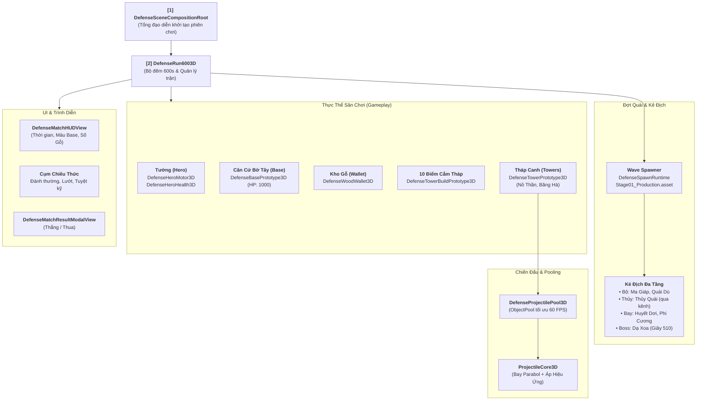

# Hướng Dẫn Kiến Trúc & Vận Hành Thủ Thành 3D — Map Sông Quê (Projectzombie)

> **Mục tiêu:** Tài liệu này chuẩn hóa và giải thích toàn bộ cấu trúc hệ thống 3D Defense bằng ngôn ngữ làm game trực quan, giúp lập trình viên và Game Designer nắm bắt 100% luồng vận hành mà không bị rối rắm bởi các tầng code trừu tượng.

---

## 1. Bản Đồ Tổng Quan (Architecture Overview)

Toàn bộ gameplay trong Scene `MapSongQue3D_Prototype.unity` được tổ chức thành **5 Trụ Cột**:

---

## 2. "Từ Điển" Tra Cứu Các Script Cốt Lõi Trên Hierarchy

Khi bạn mở Scene `MapSongQue3D_Prototype.unity`, các GameObject quan trọng nhất bao gồm:

### 🎮 Nhóm 1: Điều Hành Phiên Chơi (Session Controllers)
* **`DefenseSceneCompositionRoot` (Gắn trên GameObject Root):**
  - Đóng vai trò là "Tổng đạo diễn" chạy ở frame đầu tiên (`DefaultExecutionOrder -1000`).
  - Tự động gom các reference: Tướng, Tháp, Căn Cứ, Ví Gỗ, Giao diện kết nối lại với nhau và bấm `Start()`.
* **`DefenseRun6003D`:**
  - Bộ đếm thời gian 600 giây (10 phút).
  - Điều phối các đợt quái (`StageSpawnConfig` / `StageBlueprint`).
  - Kích hoạt sự kiện Boss Dạ Xoa xuất hiện tại phút thứ 8:30 (`bossSpawnTime: 510s`).
  - Bắt điều kiện Thắng/Thua.

### 🛡️ Nhóm 2: Phòng Thủ & Kinh Tế (Tướng, Căn Cứ, Tháp)
* **`DefenseBasePrototype3D` (Căn Cứ Bờ Tây):**
  - Máu cơ bản: `1000 HP`.
  - Quái chạy qua 3 cây cầu tới Bờ Tây sẽ lao vào tấn công Căn Cứ.
  - Khi HP = 0 ➔ Phát tín hiệu kết thúc trận (Thất Thủ).
* **`DefenseWoodWallet3D` (Ví Gỗ):**
  - Quản lý tài nguyên Gỗ (Cổ Mộc). Khởi điểm: `100 Gỗ`.
  - Quái chết rơi khối Gỗ vật lý ➔ Tướng nhặt để cộng tiền.
  - Xây mới hoặc nâng cấp tháp sẽ trừ Gỗ từ ví này.
* **`DefenseTowerBuildPrototype3D` & `DefenseTowerSocketCore` (10 Socket Tháp):**
  - Quản lý 10 vị trí cắm tháp cố định trên bản đồ.
  - Khi Tướng bước vào bán kính tương tác (`1.7m`), có thể bấm nút Xây Tháp (tiêu tốn Gỗ).
* **`DefenseTowerPrototype3D` (Tháp Canh):**
  - Tự động quét tìm quái vật gần nhất mỗi `0.2s` (tối ưu CPU mobile).
  - Lấy đạn từ `DefenseProjectilePool3D` bắn theo quỹ đạo cong parabol.
  - Gây sát thương và kích hoạt hiệu ứng (`SO_AttackEffect`): Làm Chậm (Tháp Băng) hoặc Sát thương cao (Tháp Nỏ Thần).

### 👹 Nhóm 3: Triệu Hồi Quái Vật (Wave Spawning)
* **`Stage01_Production.asset`:**
  - Bảng tổng sắp 34 Wave quái vật thiết kế sẵn theo từng giây.
* **`DefenseSpawnRuntime`:**
  - Đọc timeline và đẩy quái ra sân theo đúng Zone (Bờ Đông, Sông Quê, Trên Không).
  - Đảm bảo giới hạn hiệu năng: Tối đa 32 quái cùng lúc trên sân, tối đa sinh 4 quái/frame để không giật khung hình.

---

## 3. Các Thao Tác Thường Gặp Cho Lập Trình Viên & Designer

### 🛠️ Muốn chỉnh máu Căn Cứ hoặc Gỗ ban đầu:
1. Mở Scene `MapSongQue3D_Prototype.unity`.
2. Chọn GameObject Căn Cứ (Base) ➔ Inspector ➔ Chỉnh `maxHP` trên component **`DefenseBasePrototype3D`**.
3. Chọn GameObject Ví Gỗ ➔ Inspector ➔ Chỉnh `startingWood` trên component **`DefenseWoodWallet3D`**.

### 🏹 Muốn chỉnh tầm bắn hoặc sát thương của Tháp Canh:
* Mở file ScriptableObject cấu hình tháp:
  - Tháp Nỏ Thần: `Assets/_Data/Defense3D/Towers/SO_Tower_NoThan_Archer.asset`
  - Tháp Hàn Băng: `Assets/_Data/Defense3D/Towers/SO_Tower_BangHa_Ice.asset`
* Tinh chỉnh: `Attack Range` (Tầm bắn), `Base Damage` (Sát thương), `Fire Interval` (Tốc độ bắn), `Projectile Speed` (Tốc độ đạn).

### 🌊 Muốn thêm bớt quái hoặc đổi thời gian xuất hiện:
* Mở `Assets/Resources/Defense3D/Stages/Stage01_Production.asset`.
* Mở mục **Events** ➔ Bạn có thể thêm Wave mới, đổi `TriggerTime` (giây), đổi loại quái `Enemy`, đổi số lượng `Count`, hoặc gán quái đầu đàn `LeadEnemy`.

---

## 4. Quy Chuẩn Hiệu Năng 60 FPS Mobile Đã Tích Hợp
1. **0 GC Allocations:** Toàn bộ đạn bắn của 10 tháp canh đều dùng chung `UnityEngine.Pool.ObjectPool` ([DefenseProjectilePool3D](file:///c:/Users/thuon/Unity/Projectzombie/Assets/Features/Defense3D/Combat/Projectiles/DefenseProjectilePool3D.cs)), không gọi `Instantiate`/`Destroy` trong lúc chơi.
2. **Trail Renderer:** Được reset sạch sẽ (`Clear()`) khi sinh ra và thu hồi để triệt tiêu hiện tượng vệt đạn bị kéo dài vắt ngang màn hình.
3. **Decoupled Events:** Giao tiếp qua Event Channels `SO_FloatEvent`, `SO_IntEvent` giúp UI và Gameplay không bị phụ thuộc cứng vào nhau.
