# CẨM NANG THIẾT KẾ ẢI CHIẾN & CÂN BẰNG THỰC THỂ (STAGE & ENTITY AUTHORING GUIDE)
> **Dự Án:** Project Zombie - TREBRAVE Defense 3D (Đông Sơn Cổ Phong)  
> **Dành Cho:** Game Designer (GD), Level Designer (LD) & Combat Balancer  
> **Phiên Bản Áp Dụng:** Unity 2022.3 LTS — Kiến Trúc Data-Driven 100% ScriptableObject

---

## 1. TỔNG QUAN KIẾN TRÚC DATA-DRIVEN TRONG DEFENSE 3D

Trong phiên bản mới, toàn bộ hệ thống Ải chiến (Stages), Quái vật (Enemies), Quân lính (Minions) và Tháp thủ (Towers) đã được chuyển đổi hoàn toàn sang mô hình **Data-Driven (Điều Khiển Bằng Dữ Liệu)**:
- **100% Giao Diện Tiếng Việt Cổ Phong Đông Sơn:** Tất cả trường dữ liệu trên Unity Inspector đều có tiêu đề tiếng Việt rõ ràng, kèm Tooltip giải thích chi tiết ý nghĩa và đơn vị đo lường (giây, mét, HP, DPS).
- **Loại bỏ hoàn toàn Magic String:** Các vùng xuất hiện quái, làn đường di chuyển và loại quái vật đều được quản lý bằng Enum (`DefenseSpawnZoneType`) và ScriptableObject có tham chiếu trực tiếp.
- **Trực quan hóa không gian (Spatial Gizmos):** Không cần bấm Play Game, Game Designer chỉ cần click chọn thực thể trên Scene View là toàn bộ bán kính đánh, tầm quét mục tiêu, góc quạt nón sẽ hiển thị trực quan dưới dạng đĩa màu.
- **Bảo vệ hiệu năng di động (Mobile 60 FPS Budget):** Tích hợp sẵn bộ tiền kiểm định `DefenseStageValidator` cảnh báo ngay lập tức nếu Game Designer vô tình cấu hình quá dày đặc gây sụt giảm khung hình trên điện thoại Android.

---

## 2. QUY TRÌNH 4 BƯỚC TẠO MỘT ẢI CHIẾN MỚI (NEW STAGE)

### Bước 1: Khởi Tạo Tệp Bản Thiết Kế (Blueprint Asset)
Có 2 cách để tạo nhanh một Stage mới:
- **Cách 1 (Khuyên dùng từ mẫu có sẵn):** 
  Trên thanh Menu Unity Editor, chọn:  
  `ProjectZombie` ➔ `3. 🗺️ Stage & Level` ➔ `Dựng Stage01 Blueprint (Data-Driven Master)`.  
  Một tệp mẫu chuẩn mực `Stage01_SongQue_Blueprint.asset` sẽ tự động được sinh ra tại `Assets/Resources/Defense3D/Stages/`.
- **Cách 2 (Nhân bản để tạo Stage 02, Stage 03):**  
  Click chuột phải vào tệp `Stage01_SongQue_Blueprint` ➔ Chọn `Duplicate` (hoặc phím `Ctrl + D`), sau đó đổi tên thành `Stage02_RungTram_Blueprint.asset`.

### Bước 2: Thiết Lập Thông Tin Chung Của Ải (Stage Overview)
Chọn tệp Blueprint vừa tạo, tại cửa sổ Inspector, điền các thông số cơ bản:
- **Mã Định Danh Ải (Stage Id):** Đặt viết hoa, không dấu, ngăn cách bằng gạch dưới (Ví dụ: `STAGE_02_RUNGTRAM`).
- **Tên Hiển Thị Cổ Phong (Stage Name):** Tên gọi đậm chất dã sử Việt Nam (Ví dụ: *Rừng Tràm Dạ Quỷ*, *Bến Cát Bạch Đằng*).
- **Mô Tả Bối Cảnh (Description):** Đoạn văn ngắn giới thiệu truyền thuyết và địa hình của ải.
- **Thời Lượng Trận Chiến (Duration):** Mặc định chuẩn là **600 giây (10 phút)**.

---

## 3. THIẾT LẬP CÁC VÙNG XUẤT HIỆN QUÁI (SPAWN ZONES)

Mỗi bản đồ có cấu trúc địa hình khác nhau. Trong mục **2. VÙNG XUẤT HIỆN QUÁI**, nhấn vào danh sách `Spawn Zones` để cấu hình:

| Loại Vùng (`DefenseSpawnZoneType`) | Ý Nghĩa Chiến Thuật | Làn Đường (`Lane`) | Mô Tả Địa Hình |
|---|---|---|---|
| **EastBank** (Bờ Đông) | Quân bộ tiến công chính diện | `0` (Bắc), `1` (Giữa), `2` (Nam) | Cửa ngõ chính vượt cầu tiến về căn cứ. |
| **CanalWater** (Lòng Kênh) | Thủy quái lặn từ dưới nước | `0`, `1`, `2` | Đánh úp bất ngờ, né tránh tầm bắn xa trên bờ. |
| **NorthCanopy** (Tán Rừng Bắc) | Yêu quái bay hoặc đánh lén | `2` (Làn Bắc) | Xuất hiện từ bìa rừng, tập kích sườn phía trên. |
| **SouthBank** (Bờ Nam Đầm Lầy) | Đạo quân vu hồi, bọc hậu | `0` (Làn Nam) | Đánh vòng qua sườn phía dưới của căn cứ. |
| **ArenaEast** (Đấu Trường Boss) | Khu vực quyết chiến Đại Boss | `1` (Làn Giữa) | Vùng đất rộng mở diễn ra trận solo 1v1 cuối trận. |

> [!TIP]
> **Tọa độ tương đối (`RelativeToEastMarker`):**  
> - Bật `True` nếu muốn tọa độ các điểm xuất hiện tự động dịch chuyển theo Cột Mốc Bờ Đông của bản đồ (giúp dễ tái sử dụng trên nhiều Scene khác nhau).  
> - Bật `False` nếu muốn đặt tọa độ thế giới tuyệt đối (Ví dụ: Lòng kênh nước cố định).

---

## 4. THIẾT KẾ TIMELINE ĐỢT SÓNG QUÁI (WAVE PACING)

Mỗi trận đấu kéo dài 10 phút được chia thành 4 giai đoạn nhịp điệu (Combat Pacing):

```mermaid
gantt
    title Nhịp Điệu 10 Phút Chiến Đấu Defense 3D
    dateFormat  X
    axisFormat %s giây

    section Nhịp Điệu
    Giai Đoạn Khởi Đầu (Nhập Cuộc)      :active, 0, 120
    Giai Đoạn Leo Thang (Tăng Cường)   :120, 360
    Giai Đoạn Cao Trào (Hỗn Chiến)     :360, 510
    Đại Quyết Chiến (Arena Boss)       :crit, 510, 555
    Hạ Màn / Kết Thúc                  :555, 600
```

1. **Khởi Đầu (00:00 - 02:00 / 0s - 120s):**
   - Chỉ xuất hiện từng nhóm nhỏ 1–3 Ma Giáp Bộ Binh từ Bờ Đông.
   - Mục đích: Cho phép người chơi chặt gỗ, xây 1–2 Tháp Cung cơ bản và triệu hồi Lính Cận Chiến đầu tiên.
2. **Leo Thang (02:00 - 06:00 / 120s - 360s):**
   - Bắt đầu mở rộng xuất hiện Thủy Quái từ Lòng Kênh (`CanalWater`) và Quái Bọc Hậu Bờ Nam (`SouthBank`).
   - Xuất hiện Phi Cương (`leadEnemy`) dẫn đầu đàn Ma Giáp.
3. **Cao Trào (06:00 - 08:30 / 360s - 510s):**
   - Dồn dập đa hướng: Thủy - Bộ - Tán Cây phối hợp.
   - Số lượng quái mỗi đợt tăng lên 4–6 con.
4. **Đại Quyết Chiến Boss Đấu Trường (08:30 - 09:15 / 510s - 555s):**
   - **Tạm dừng** sinh quái thường để tập trung toàn lực vào Đại Boss Dạ Xoa (`arenaBoss`).
   - Boss xuất hiện tại Đấu Trường phía Đông với lượng máu chỉ định (`bossHealthOverride = 1200 HP`).
   - Người chơi có **45 giây** (`arenaDuration`) để hạ Boss trước khi hết giờ.

---

## 5. BỘ CÔNG CỤ TRỰC QUAN HÓA TRÊN SCENE VIEW (GIZMOS & HANDLES)

Để giúp Game Designer dễ dàng căn chỉnh khoảng cách an toàn và tầm ảnh hưởng, hệ thống tự động vẽ Scene Gizmos khi click chọn các GameObject:

| Đối Tượng | Màu Sắc Gizmo | Bán Kính Hiển Thị | Ý Nghĩa Cho Game Designer |
|---|---|---|---|
| **Tháp Cung** | 🏹 **Cyan** (Xanh Lam Biển) | `EffectiveRange` (Bán kính 8.5m) | Vùng tháp tự động phát hiện và bắn tên. |
| **Anh Hùng** | ⚔️ **Green** (Xanh Lục) | `Range` (Bán kính 3.5m) | Vùng chém kiếm cơ bản / tự động áp sát. |
| **Quân Lính** | 🛡️ **Teal** (Xanh Ngọc) | `AttackRange` (Bán kính 1.2m) | Khoảng cách vung gươm cận chiến của lính. |
| **Quân Lính** | 🟡 **Yellow** (Vàng Nhạt mờ) | `SearchRange` (Bán kính 8.0m) | Vùng quét tìm yêu quái để tự động lao tới chặn đánh. |
| **Yêu Quái** | 👹 **Orange-Red** (Đỏ Cam) | `AttackRange` (Bán kính 1.5m) | Tầm đánh trúng mục tiêu (Tháp hoặc Anh Hùng). |
| **Yêu Quái** | 🟠 **Amber** (Cam Vàng mờ) | `AggroRange` (Bán kính 8.0m) | Vùng cảnh giác: Quái sẽ bỏ làn đi thẳng để lao vào người chơi. |
| **Boss Dạ Xoa**| 💥 **Transparent Red** (Đỏ Nón) | Góc $120^\circ$, Bán kính 4.5m | Quạt nón sát thương đòn quét `DefenseConeAttack3D`. |

---

## 6. TIỀN KIỂM ĐỊNH HỢP LỆ TRƯỚC KHI BUILD (PRE-FLIGHT VALIDATOR)

Trước khi gửi bản cấu hình cho Tester hoặc đóng gói APK Android, Game Designer chỉ cần:
1. Mở Inspector của `DefenseStageBlueprintSO`.
2. Bấm nút **`🔍 Kiểm Tra Hợp Lệ (Validate)`**.

Hệ thống sẽ chạy bộ phân tích `DefenseStageValidator` và trả về kết quả ngay lập tức:

### Các lỗi nghiêm trọng bắt buộc sửa (Errors):
- ❌ **Thiếu Prefab hoặc Component:** Quái vật chưa gán Prefab 3D hoặc Prefab bị thiếu script `DefenseEnemyBridgeWalker3D`.
- ❌ **Chưa gán Boss hoặc Máu <= 0:** Bắt buộc phải có Boss Đấu Trường với lượng máu dương hữu hạn.
- ❌ **Vùng chưa định nghĩa:** Đợt quái chỉ định vùng (ví dụ: `CanalWater`) nhưng danh sách `SpawnZones` chưa khai báo vùng này.
- ❌ **Thời gian ngoài phạm vi:** Đợt quái kích hoạt tại giây $t \ge 600\text{s}$ hoặc $t < 0\text{s}$.
- ❌ **Trùng lặp EventId:** Hai đợt quái có cùng mã định danh.

### Các cảnh báo hiệu năng trên di động (Warnings):
- ⚠️ **Quá tải mật độ:** Một đợt quái sinh nhiều hơn 32 con cùng lúc (`wave.count > maxActiveEnemies`). Khuyến nghị chia nhỏ thành 2 đợt cách nhau 3–5 giây.
- ⚠️ **Khoảng cách quá dày (< 1.0s):** Hai đợt sóng xuất hiện quá sát nhau có thể gây nghẽn bộ đệm `PendingQueue`.

---

## 7. CHECKLIST HOÀN THÀNH DÀNH CHO GAME DESIGNER

- [ ] Đã đặt `StageId` và `StageName` chuẩn Cổ Phong Đông Sơn.
- [ ] Đã kiểm tra 5 Vùng xuất hiện quái trên Scene View (không bị lún sâu xuống đất hoặc treo lơ lửng).
- [ ] Đã nhấn **`⏱️ Sắp Xếp Theo Thời Gian`** để các đợt sóng hiển thị tuần tự.
- [ ] Đã kiểm tra thanh Timeline màu để đảm bảo nhịp điệu phân bổ quái Bộ - Thủy - Không hài hòa.
- [ ] Đã gán đầy đủ Đại Boss Dạ Xoa và chỉ số máu tương ứng với độ khó màn chơi.
- [ ] Đã bấm **`🔍 Kiểm Tra Hợp Lệ (Validate)`** và nhận thông báo: `✅ CẤU HÌNH HỢP LỆ HOÀN TOÀN!`.
- [ ] Chạy thử một trận hoàn chỉnh (10 phút) trong Unity Editor để cảm nhận độ căng thẳng và lượng tài nguyên (Gỗ, Vàng, EXP).
