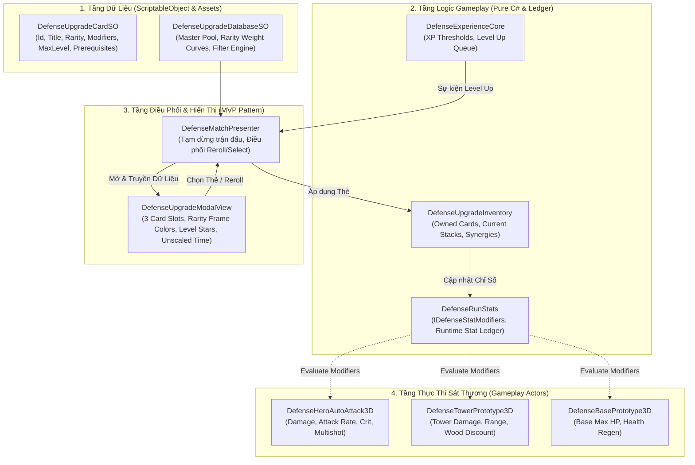

# 🎴 Thiết Kế Kiến Trúc: Hệ Thống Thẻ Bài Nâng Cấp Roguelite (In-Run Perks System)

Tài liệu này xác lập bản phân tích toàn diện và kiến trúc thiết kế hệ thống thẻ bài nâng cấp trong trận (**In-Run Roguelite Perks**) của **Projectzombie**, chuyển đổi từ mô hình gán cứng 6 thẻ trong C# sang kiến trúc **Dữ Liệu Hóa (Data-Driven qua ScriptableObjects), Phân Cấp Phẩm Chất (Rarity System), Đa Dạng Hóa Chiến Thuật (16+ Chỉ Số & Hiệu Ứng Nguyên Tố) và Trải Nghiệm Chọn Thẻ Đỉnh Cao (MVP 3-Card Draft Modal)** đạt chuẩn **60 FPS Mobile 0 GC Allocations**.

---

## 🔍 1. Phân Tích Hiện Trạng & Nỗi Đau Kỹ Thuật (Pain Points)

```text
[HIỆN TẠI]
DefenseUpgradeDeck.cs (Hardcoded 6 cards in C#)
      │
      ▼
6 Chỉ số đơn điệu (Damage, Aspd, Spd, TowerDmg, TowerRng, BaseHp)
      │
      ▼
Không Phẩm Cấp • Không Max Stacks • Không Điều Kiện Tiên Quyết • UI Thô
```

| Thành Phần | Hiện Trạng Trong Source Code | Hạn Chế & Rủi Ro |
|---|---|---|
| **Lưu trữ dữ liệu thẻ** | Hardcode 6 thẻ cố định trong C# (`DefenseUpgradeDeck.cs` lines 50–57) | Game Designer (GD) **hoàn toàn không thể tự tạo hoặc sửa thẻ**; muốn thêm 1 thẻ mới phải mở code C# lên viết, vi phạm quy tắc Single Responsibility & Data-Driven. |
| **Phẩm cấp (Rarity)** | Chưa có phẩm cấp; mọi thẻ đều có trọng số xuất hiện ngang nhau (1/6) | Thiếu cảm giác hồi hộp, "bùng nổ Dopamine" đặc trưng của thể loại Roguelite khi mở trúng thẻ Hiếm (**Rare**), Sử Thi (**Epic**) hay Truyền Thuyết (**Legendary**). |
| **Loại chỉ số nâng cấp** | Chỉ có 6 chỉ số tuyến tính cơ bản (`HeroAttackDamage`, `HeroAttackSpeed`, `HeroMoveSpeed`, `TowerDamage`, `TowerAttackRange`, `BaseMaxHp`) | **Lối chơi bị đơn điệu**: Thiếu các cơ chế chiến đấu đột biến như Bạo kích (*Crit*), Bắn nhiều tia đạn (*Multishot*), Bắn xuyên (*Pierce*), Sấm sét lan (*Chain Lightning*), Thiêu đốt (*Burn*), Hồi máu căn cứ (*Regen*), và Kinh tế Cổ Mộc (*Wood Drop Bonus*). |
| **Cấp độ thẻ (Progression/Stack)** | Không giới hạn số lần nhặt thẻ, không có cấp độ thẻ (Level 1 $\rightarrow$ 5) | Người chơi có thể nhặt 1 thẻ vô hạn lần mà không có trần giới hạn (*Max Level*), không có cơ chế tiến hóa khi max cấp. |
| **Cộng hưởng & Điều kiện (Synergies/Prerequisites)** | Rút ngẫu nhiên thuần túy, không có điều kiện ràng buộc | Không thể thiết lập các chuỗi bài kết hợp (ví dụ: Phải có bùa *"Hỏa Thiêu Lv.2"* mới có cơ hội rút được tuyệt kỹ *"Thiên Hỏa Phần Thành"*). |
| **Giao diện (UI/UX)** | `DefenseUpgradeModalView` chỉ hiển thị Text đơn giản, chưa có Icon, chưa có màu sắc theo phẩm cấp | Người chơi khó nhận diện nhanh thẻ mạnh/yếu trên màn hình cảm ứng di động; thiếu hoạt ảnh lật bài (*Card Flip*). |

---

## 🏗️ 2. Kiến Trúc Hệ Thống Mới Đề Xuất (To-Be Architecture)



---

## 📋 3. Chi Tiết Thiết Kế Kỹ Thuật

### 3.1. Phân Cấp Phẩm Chất Thẻ (Card Rarity System)

| Phẩm Cấp | Màu Sắc Nhận Diện | Tỷ Lệ Xuất Hiện Đầu Trận (Lv. 1-3) | Tỷ Lệ Xuất Hiện Cuối Trận (Lv. 8+) | Đặc Trưng Thiết Kế |
|---|---|---|---|---|
| ⚪ **Bạch Sắc (Common)** | `#FFFFFF` | 80% | 35% | Chỉ số cơ bản: Tăng 10–15% Sát thương, Tốc đánh, Tốc chạy, Máu nhà. |
| 🟢 **Bích Sắc (Rare)** | `#2196F3` | 18% | 35% | Chỉ số chiến thuật: Tầm bắn tháp, Tỷ lệ bạo kích, Giảm giá xây tháp. |
| 🟣 **Tử Sắc (Epic)** | `#9C27B0` | 2% | 22% | Cơ chế đột biến: Sét giật lan, Đóng băng làm chậm quái, Hồi máu căn cứ. |
| 🟡 **Kim Sắc (Legendary)** | `#FFD700` | 0% | 8% | Tuyệt kỹ tối thượng: Bắn thêm tia đạn (Multishot), Bão lửa diện rộng, Trụ bắn xuyên vô hạn. |

---

### 3.2. Mở Rộng Hệ Thống Chỉ Số Chiến Thuật (`DefenseUpgradeType`)

Mở rộng từ 6 chỉ số tuyến tính lên **16 chỉ số chiến thuật đa dạng**:

```csharp
namespace ProjectZombie.Features.Defense3D
{
    public enum DefenseUpgradeType
    {
        // === TƯỚNG (HERO COMBAT) ===
        HeroAttackDamage = 0,       // Sát thương đòn đánh
        HeroAttackSpeed = 1,        // Tốc độ ra đòn
        HeroMoveSpeed = 2,          // Tốc độ di chuyển
        HeroCritChance = 3,         // Tỷ lệ bạo kích (0% -> 100%)
        HeroCritDamage = 4,         // Hệ số sát thương bạo kích (+50%, +100%)
        HeroMultishot = 5,          // Bắn thêm tia đạn (+1, +2)
        HeroPierceCount = 6,        // Số mục tiêu đạn xuyên qua

        // === NGUYÊN TỐ (ELEMENTAL PROCS) ===
        BurnChance = 7,             // Cơ hội thiêu đốt gây DoT
        BurnDamage = 8,             // Sát thương thiêu đốt mỗi nhịp
        FreezeChance = 9,           // Cơ hội làm chậm / đóng băng
        ChainLightningChance = 10,  // Cơ hội giật sét lan

        // === THÁP PHÒNG THỦ (TOWERS) ===
        TowerDamage = 11,           // Sát thương tháp
        TowerAttackRange = 12,      // Tầm bao quát của tháp
        TowerAttackRate = 13,       // Tốc độ bắn của tháp
        TowerBuildDiscount = 14,    // Giảm lượng Gỗ khi xây / nâng cấp

        // === CĂN CỨ & KINH TẾ (BASE & ECONOMY) ===
        BaseMaxHp = 15,             // Máu tối đa căn cứ
        BaseHpRegen = 16,           // Hồi máu căn cứ mỗi giây
        WoodDropMultiplier = 17,    // Hệ số nhân Gỗ rơi ra từ quái
        ExpMultiplier = 18          // Tốc độ tăng cấp (EXP boost)
    }
}
```

---

### 3.3. Danh Mục 20 Thẻ Bài Mẫu Chuẩn Cổ Phong Đông Sơn

#### ⚪ Nhóm Bạch Sắc (Common - 6 thẻ)
1. **Thư Kiếm Hợp Nhất** (`card_hero_dmg`): +15% Sát thương Tướng.
2. **Bút Tẩu Long Xà** (`card_hero_aspd`): +12% Tốc đánh Tướng.
3. **Lăng Ba Vi Bộ** (`card_hero_spd`): +10% Tốc chạy Tướng.
4. **Hỏa Pháo Cường Hóa** (`card_tower_dmg`): +20% Sát thương Tháp.
5. **Thiên Lý Nhãn** (`card_tower_rng`): +15% Tầm bắn Tháp.
6. **Thành Kiên Đao Cố** (`card_base_hp`): +250 Máu Căn Cứ.

#### 🟢 Nhóm Bích Sắc (Rare - 6 thẻ)
7. **Bách Bộ Xuyên Dương** (`card_hero_crit_chance`): +15% Tỷ lệ Bạo Kích Tướng.
8. **Đoạn Kim Trảm Kích** (`card_hero_crit_dmg`): +40% Sát thương Bạo Kích.
9. **Cơ Quan Tinh Giảo** (`card_tower_discount`): Giảm 15 Gỗ khi xây & nâng cấp Tháp.
10. **Liên Hoàn Nỏ Tiễn** (`card_tower_aspd`): +20% Tốc bắn của Tháp.
11. **Cổ Mộc Phong Nhiêu** (`card_wood_boost`): +25% Lượng Gỗ rớt từ quái vật.
12. **Bản Đồ Thiên Lộc** (`card_exp_boost`): +20% Điểm EXP nhận được.

#### 🟣 Nhóm Tử Sắc (Epic - 5 thẻ)
13. **Lôi Đình Vạn Quân** (`card_proc_lightning`): 25% Đòn đánh kích hoạt Sấm Sét giật lan 3 quái.
14. **Hàn Băng Thấu Xương** (`card_proc_freeze`): 30% Đòn đánh làm chậm quái 40% trong 2.5s.
15. **Hỏa Long Phần Dã** (`card_proc_burn`): 35% Đòn đánh thiêu đốt gây sát thương kéo dài 3s.
16. **Bút Khí Xuyên Vân** (`card_hero_pierce`): Đạn Tướng bắn xuyên qua thêm 1 mục tiêu.
17. **Trúc Lâm Sinh Cơ** (`card_base_regen`): Hồi phục 15 Máu Căn Cứ mỗi giây.

#### 🟡 Nhóm Kim Sắc (Legendary - 3 thẻ)
18. **Tam Hoa Tụ Đỉnh** (`card_hero_multishot`): Bắn thêm 1 tia đạn hình nón về phía trước.
19. **Thiên Cương Trận Pháp** (`card_tower_synergy`): Tướng đứng gần Tháp tăng 35% sát thương cho cả 2.
20. **Bất Tử Kim Cang** (`card_base_thorns`): Căn Cứ phản lại 50% sát thương nhận vào thành sát thương nổ diện rộng.

---

### 3.4. Tối Ưu Giao Diện & Hiệu Năng 60 FPS Mobile (Zero GC)
* **Unscaled Time Animation:** Modal xuất hiện khi `Time.timeScale = 0`. Mọi `Animator` trên View bắt buộc cấu hình `animator.updateMode = AnimatorUpdateMode.UnscaledTime` (tuân thủ **Quy tắc 12.6**).
* **Pre-cached Slots:** 3 thẻ lựa chọn được cấp phát sẵn trong Canvas Hierarchy, View chỉ cập nhật Text, Icon và màu sắc viền; **tuyệt đối không `Instantiate` UI mới** lúc mở popup (tuân thủ **Quy tắc 6.1**).
* **Tắt Raycast Target:** Mọi Image khung viền, nền, icon kỹ năng đều tắt `raycastTarget = false`, chỉ nút bấm nhận chạm mới bật (tuân thủ **Quy tắc 6.3**).

---

## 🛠️ 4. Lộ Trình 4 Giai Đoạn Triển Khai

- [ ] **Giai Đoạn 1: Cấu Trúc Dữ Liệu ScriptableObject**
  - Tạo `DefenseUpgradeCardSO.cs` và `DefenseUpgradeDatabaseSO.cs`.
  - Tạo 20 file ScriptableObject `.asset` cho bộ thẻ Cổ Phong mẫu.
- [ ] **Giai Đoạn 2: Mở Rộng Hệ Thống Chỉ Số & Inventory**
  - Cập nhật `DefenseUpgradeType.cs` (16 chỉ số).
  - Cập nhật `DefenseRunStats.cs` và `IDefenseStatModifiers.cs`.
  - Tạo `DefenseUpgradeInventory.cs` quản lý stack và điều kiện tiên quyết.
  - Tích hợp tính toán Crit, Multishot, Wood Discount vào `DefenseHeroAutoAttack3D` và `DefenseTowerPrototype3D`.
- [ ] **Giai Đoạn 3: Tích Hợp MVP Presenter & Nâng Cấp Modal View**
  - Cập nhật `DefenseUpgradeModalView.cs` với màu sắc phẩm cấp (Common, Rare, Epic, Legendary), hiển thị sao cấp độ và icon.
  - Kết nối `DefenseExperienceCore` $\rightarrow$ `DefenseUpgradeDatabaseSO` $\rightarrow$ `DefenseMatchPresenter`.
- [ ] **Giai Đoạn 4: Bộ Test Kiểm Định NUnit & Regression Verification**
  - Viết `InRunUpgradeCardTests.cs` (Kiểm tra xác suất Weighted Random, giới hạn Max Level, điều kiện tiên quyết, và 0 GC Alloc).
  - Chạy regression test suite đảm bảo 138/138 tests hiện tại tiếp tục xanh 100%.
