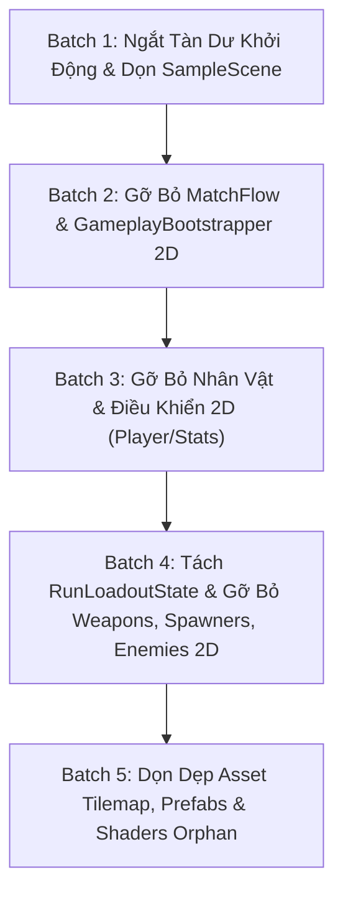

# Kế Hoạch Thực Hiện G6 — Ngắt Và Loại Bỏ Gameplay 2D [ĐÃ HOÀN THÀNH]

Cập nhật: 28/10/2026.  
Trạng thái: **ĐÃ HOÀN THÀNH 100% (Batch 1 -> Batch 5)**  
Tài liệu định hướng chi tiết cho giai đoạn **G6** theo lộ trình tổng thể [DEFENSE3D_GAMEPLAY_MIGRATION_PLAN.md](file:///c:/Users/thuon/Unity/Projectzombie/Docs/DEFENSE3D_GAMEPLAY_MIGRATION_PLAN.md).

---

## 1. Nguyên Tắc Cốt Lõi Khi Thực Hiện G6

1. **Thực hiện theo từng Batch nhỏ:** Tuyệt đối không xóa diện rộng cùng lúc; mỗi batch phải độc lập và đảm bảo biên dịch thành công 100%.
2. **Gỡ Consumer trước -> Gỡ Provider sau:** Phải ngắt các nơi đang gọi mã 2D trước khi xóa chính mã nguồn 2D đó.
3. **Không xóa thô theo thư mục:** Không xóa cả thư mục `Features/UI/`, `Features/Shared/` hoặc `Features/Weapons/` vì có chứa các thành phần dùng chung hoặc dữ liệu catalog/icon cần giữ.
4. **Bảo toàn tính nguyên vẹn của Save & Meta:** Không xóa hoặc làm thay đổi cấu trúc `MetaProgressionSaveData` và `SaveSystem`.
5. **Bảo toàn SDK Mạng (Photon Fusion):** Giữ nguyên package Photon Fusion và các interface mạng; chỉ cô lập hoặc thay thế các adapter gameplay 2D cũ.
6. **Kiểm chứng biên dịch liên tục:** Sau mỗi batch, bắt buộc chạy kiểm tra biên dịch Mono standalone và chạy lại bộ kiểm tra 59 checks `DefenseLoadoutCoreChecks`.

---

## 2. Kế Hoạch Chi Tiết 5 Batch

---

### BATCH 1: Ngắt Tàn Dư Khởi Động Trận Đấu & Dọn Dẹp Scene SampleScene

#### Mục tiêu:
Biến `SampleScene.unity` thành Scene Sảnh Menu chuyên trách (Dedicated Main Hub), ngắt hoàn toàn các hook khởi động 2D trong `MetaSceneTransitionController`.

#### Các công việc cụ thể:
1. **Cắt tỉa mã lệnh tàn dư trong `MetaSceneTransitionController.cs`:**
   - Xóa các dòng tham chiếu và gán timeline cho Spawner 2D: `_spawnManager.SetTimelineConfig(...)`.
   - Xóa lời gọi `CheckAndPromptInitialMythicCore()` (kiểm tra player 2D).
   - Đơn giản hóa `TransitionToMetaHubRoutine()`: Bỏ các lệnh gọi despawn quái vật/đạn 2D cũ vì khi chuyển sang Scene 3D thì 2D đã không còn chạy.
2. **Dọn dẹp cây phân cấp `SampleScene.unity`:**
   - Xóa 15 GameObject con của `--- GAME MANAGER ---` (Player 2D, EnemyManager 2D, Spawners 2D, Camera 2D, Tilemap 2D, GameplayHUD 2D) đã được lập hồ sơ ở G0.
   - Giữ lại `--- GAME MANAGER ---` (chỉ chứa `GameStateManager`), `--- CORE SYSTEMS ---`, và Canvas `MainHubUI`.

#### Tiêu chí nghiệm thu:
- `SampleScene` khi mở lên không sinh ra Player 2D hay Spawner 2D.
- Bấm "Xuất Trận" chuyển sang Defense 3D mượt mà không có bất kỳ log cảnh báo nào về các component 2D bị null.

---

### BATCH 2: Gỡ Bỏ MatchFlow & GameplayBootstrapper 2D

#### Mục tiêu:
Loại bỏ hoàn toàn các bộ điều phối vòng đời trận đấu 2D kiểu cũ.

#### Các công việc cụ thể:
1. **Gỡ bỏ bộ MatchFlow:**
   - `Assets/Features/MatchFlow/MatchFlowService.cs`
   - `Assets/Features/MatchFlow/MatchFlowOrchestrator.cs`
2. **Gỡ bỏ GameplayBootstrapper:**
   - `Assets/Features/Player/GameplayBootstrapper.cs`
3. **Cắt bỏ các tham chiếu tới MatchFlow/Bootstrapper:**
   - Rà soát các UI Presenter (`MainHubPresenter`, `MetaSceneTransitionController`) để xóa bỏ mọi `[SerializeField]` hoặc biến tham chiếu đến hai hệ thống này.

#### Tiêu chí nghiệm thu:
- Dự án không còn class `MatchFlowService` và `GameplayBootstrapper`.
- Biên dịch 0 lỗi, toàn bộ tests của G1-G5 chạy sạch.

---

### BATCH 3: Gỡ Bỏ Nhân Vật & Điều Khiển 2D (Player 2D & Stats 2D)

#### Mục tiêu:
Loại bỏ toàn bộ controller, motor vật lý 2D, hoạt ảnh và hệ thống tính chỉ số máu/giáp/exp 2D cũ.

#### Các công việc cụ thể:
1. **Gỡ bỏ Runtime Nhân Vật 2D:**
   - `PlayerController.cs`, `PlayerMotor2D.cs`, `PlayerMovement.cs`, `PlayerAnimationState.cs`.
   - `PlayerMythicManager.cs`.
2. **Gỡ bỏ Hệ thống Chỉ số & Kinh Nghiệm 2D:**
   - `PlayerStats.cs`, `PlayerExperience.cs`, `PlayerLevelManager.cs`, `PlayerHealthBar.cs`.
   - `PlayerProvider.cs`.
3. **Xử lý các caller còn phụ thuộc:**
   - Trong `Features/UI/`, rà soát các Presenter hiển thị thông tin nhân vật để chuyển sang đọc từ Catalog Defense 3D hoặc MetaProgression thay vì đọc `PlayerStats`.

#### Tiêu chí nghiệm thu:
- Toàn bộ thư mục `Assets/Features/Player/` được dọn sạch các script runtime 2D.
- Gameplay Defense 3D hoạt động hoàn hảo với `DefenseHeroMotor3D`, `DefenseHeroHealth3D` và `DefenseExperienceCore`.

---

### BATCH 4: Tách Rời RunLoadoutState & Gỡ Bỏ Weapons, Spawners, Enemies 2D

#### Mục tiêu:
Giải phóng điểm nút `RunLoadoutState`, tách UI Sảnh khỏi runtime vũ khí 2D và gỡ bỏ toàn bộ quái vật/spawner 2D cũ.

#### Các công việc cụ thể:
1. **Tách rời `RunLoadoutState`:**
   - Chuyển `MainHubPresenter`, `WeaponLoadoutPresenter`, `CharacterSelectionPresenter` sang đọc trực tiếp từ `Defense3DCatalog` và `DefenseLoadoutRepository`.
   - Cập nhật `NetworkPlayerSpawner` và `NetworkLobbySync` (Multiplayer) để sử dụng snapshot ID từ `DefenseSessionContext` thay vì đọc `RunLoadoutState`.
   - Gỡ bỏ `RunLoadoutState.cs`.
2. **Gỡ bỏ Hệ thống Vũ Khí & Đạn 2D:**
   - `WeaponManager.cs`, `WeaponController.cs`, `WeaponData.cs` (logic runtime), `ProjectileSystem.cs`, `BatQuaiTranZone.cs`.
3. **Gỡ bỏ Spawners & Enemies 2D:**
   - `SpawnManager.cs`, `EnemyPoolManager.cs` (2D), `WaveConfigSO.cs`, `TimelineConfigSO.cs`.
   - `ZombieMovement.cs`, `EnemyAI2D.cs`, `EnemyAttack2D.cs`.
   - `ExpGem.cs`, `ChestPickup.cs` (Collectibles 2D).

#### Tiêu chí nghiệm thu:
- Runtime 2D của vũ khí và quái vật bị loại bỏ hoàn toàn.
- UI Sảnh Vong Xuyên và chế độ Defense 3D đồng bộ 100% qua chuẩn Loadout mới.

---

### BATCH 5: Dọn Dẹp Asset Tilemaps, Prefabs & Shaders Orphan

#### Mục tiêu:
Dọn sạch các asset nặng (Prefabs, Tilemaps, Shaders) không còn consumer trong dự án nhằm tối ưu hóa dung lượng build APK.

#### Các công việc cụ thể:
1. **Dọn dẹp Asset Bản đồ 2D:**
   - Gỡ bỏ các Prefab Tilemap, Grid 2D trong `Assets/Features/Maps/`.
   - Xóa hoặc cập nhật trường `mapPrefab` trong `StageDefinitionSO`.
2. **Rà soát & Dọn dẹp Shaders/Materials:**
   - Đối chiếu danh sách Shader theo tiêu chuẩn G0: Giữ nguyên các shader `Defense*` và các shader VFX/Billboard còn consumer.
   - Gỡ bỏ các Shader chỉ phục vụ cho Sprite 2D đã bỏ.
3. **Đóng gói & Chốt G6:**
   - Cập nhật `SYSTEM_MANIFEST.md` và `MIGRATION_STATUS.md`.
   - Chạy kiểm thử toàn bộ test suites và kiểm tra trạng thái working tree.

---

## 3. Ma Trận Đánh Giá Rủi Ro & Biện Pháp Kiểm Soát

| Batch | Rủi ro tiềm ẩn | Mức độ | Biện pháp kiểm soát |
|---|---|:---:|---|
| **Batch 1** | Mất reference trên Canvas UI Sảnh | Thấp | Chỉ xóa 15 con của `--- GAME MANAGER ---`, giữ nguyên root Sảnh `MainHubUI`. |
| **Batch 2** | Gãy compile các UI Presenter gọi Bootstrapper | Trung bình | Gỡ bỏ các trường SerializeField trên Presenter trước khi xóa file script. |
| **Batch 3** | Các UI Info còn cố truy xuất `PlayerStats.Instance` | Trung bình | Grep toàn bộ codebase tìm `PlayerStats` và thay thế bằng null-guard hoặc Meta Adapter. |
| **Batch 4** | Gãy compile hệ thống Multiplayer (Photon Fusion) | Cao | Rà soát `NetworkPlayerSpawner`, giữ interface phòng và adapter snapshot thay vì xóa thô. |
| **Batch 5** | Mất shader dùng chung trong URP | Trung bình | Không xóa shader bằng tên; chỉ xóa khi không có Material hoặc ScriptableRenderer nào tham chiếu. |
