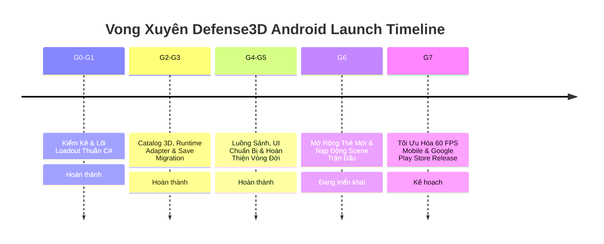

# Lộ Trình Phát Triển Dự Án — VONG XUYÊN (Defense3D Android Roadmap)

**Dự án:** Vong Xuyên — 3D Top-Down Survival & Tower Defense (Defense3D)  
**Nền tảng:** Android Mobile (Google Play Store — Target API 33+, IL2CPP ARM64)  
**Phiên bản mục tiêu:** MVP 1.0 (Store Release)  
**Tài liệu điều phối chính:** [TASK.md](file:///c:/Users/thuon/Unity/Projectzombie/TASK.md) | [MIGRATION_STATUS.md](file:///c:/Users/thuon/Unity/Projectzombie/MIGRATION_STATUS.md)

---

## 🎯 Tổng Quan Lộ Trình (Milestone Overview)

---

## 📌 Chi Tiết Các Cột Mốc Kỹ Thuật

### ✅ G0 — Kiểm Kê & Cô Lập Phụ Thuộc (Done)
- [x] Cô lập `DontDestroyOnLoad` cho `--- GAME MANAGER ---` trong `GameStateManager.cs`, dọn sạch các đối tượng cũ khi nạp Scene 3D.
- [x] Rà soát cấu trúc Sảnh `MainMenu.unity` và tách biệt hoàn toàn luồng xuất trận.

### ✅ G1 — Lõi Loadout Thuần C# (Done)
- [x] Triển khai hệ thống `LoadoutRules`, `LoadoutSelection`, `LoadoutValidator`, `DefenseLoadoutSnapshot`.
- [x] 13 Tests NUnit toàn diện trong `Assets/Tests/Editor/DefenseLoadoutCoreTests.cs` đạt 100% PASS.

### ✅ G2 — Danh Mục Catalog 3D & Adapter Runtime (Done)
- [x] Xây dựng `Defense3DCatalog` và bộ phân giải `DefenseLoadoutResolver`.
- [x] Triển khai `DefenseLoadoutRuntimeAdapter` kết nối dữ liệu đội hình vào `DefenseVillageShop3D` và `DefenseHeroKitSO`.

### ✅ G3 — Save Migration & Meta Adapter (Done)
- [x] Xây dựng `DefenseLoadoutRepository` lưu file `defense_loadout.json` với cơ chế ghi Atomic an toàn.
- [x] Xây dựng `DefenseMetaOwnershipAdapter` và `DefenseLoadoutIdMapper` đồng bộ với tiến trình Cấp Sao Tướng/Pháp bảo.

### ✅ G4 — Luồng Sảnh & UI Chuẩn Bị Xuất Trận (Done)
- [x] Triển khai `DefensePreparationPresenter` quản lý trạng thái chọn đội hình và kích hoạt nút Xuất Trận.
- [x] Tích hợp `DefenseMatchNavigation` nạp Scene `MapSongQue3D_Prototype.unity` thông qua `AppFlowController`.

### ✅ G5 — Hoàn Thiện Vòng Đời Trận Đấu & Trở Về Sảnh (Done)
- [x] Dịch vụ `DefenseMatchResultService` tính thưởng Cổ Tiền và cập nhật kỷ lục người chơi.
- [x] Điều hướng `DefenseNavigationService` dọn dẹp sạch sẽ tài nguyên và chuyển về Sảnh chính.
- [x] Thống nhất Font Asset TMP sang `GameFont_Vietnamese_SD` (triệt tiêu `TMP_SubMeshUI` NullReferenceException).
- [x] Mở rộng Menu Xây Tháp lên 3 hàng UI (sửa lỗi crash `Build menu has fewer rows than tower catalog entries`).

### 🟡 G6 — Mở Rộng Danh Mục & Nạp Động Scene Trận Đấu (In Progress)
- [x] Mở rộng danh mục Catalog với 4 thực thể mới: Tướng Đạo Sĩ (`hero_daosi`), Pháp Bảo Điếu Cày Khói Lửa (`relic_dieucay`), Lính Xạ Thủ Nỏ Thần (`minion_xathu`), Tháp Hỏa Long (`tower_hoalong`).
- [/] Nạp động trong Scene trận chiến (Dynamic Scene Binding):
  - [ ] Hoán đổi Pháp bảo Điếu Cày Khói Lửa (`DefensePipeRelicEffect3D`).
  - [ ] Hoán đổi Tuyệt Kỹ Tướng Đạo Sĩ (`DefenseLightningSignatureEffect3D`).
  - [ ] Hoán đổi Lính chiêu mộ trong Lều Dân Làng (`Minion_XaThu.asset`).
  - [ ] Hoán đổi mô hình 3D nhân vật theo Tướng đã chọn.

### 🔴 G7 — Tối Ưu Hóa Hiệu Năng & Đóng Gói Android Release (Backlog)
- [ ] Tối ưu hóa Draw Call, đóng gói Sprite Atlas (Draw Calls < 40).
- [ ] Stress test 60 FPS ổn định trên thiết bị Android với 150+ quái và 80+ đạn.
- [ ] Xuất bản file `.aab` (Android App Bundle) với cấu hình IL2CPP ARM64-v8a đạt chuẩn Google Play Store Release.
