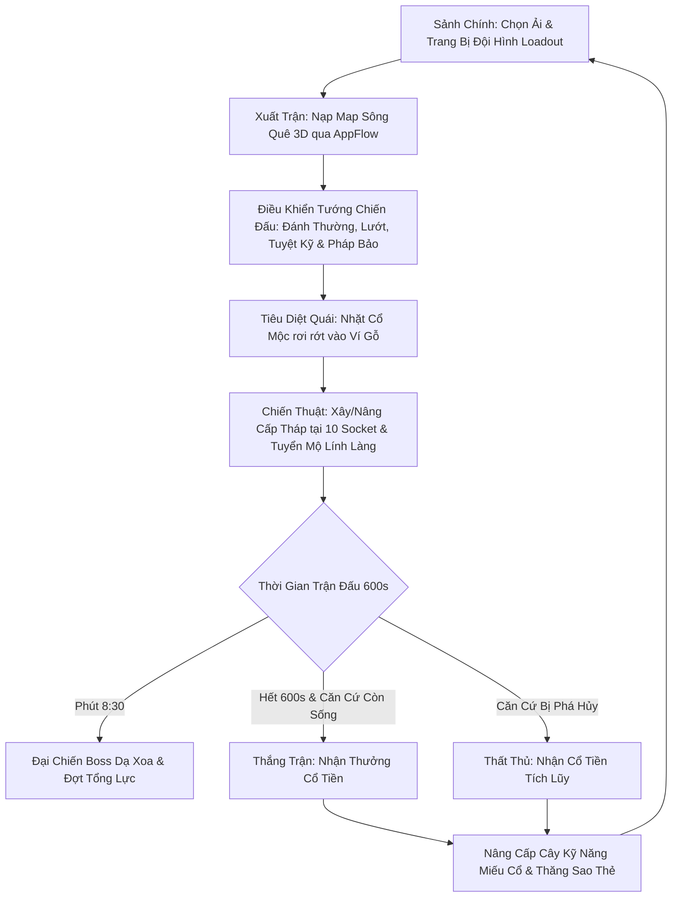
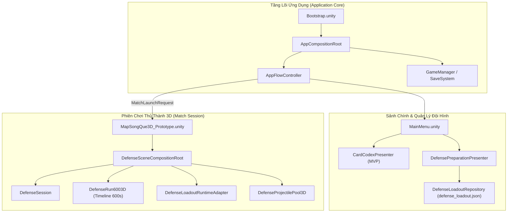

# 🌊 VONG XUYÊN — 3D Top-Down Survival & Tower Defense (Defense3D)

[](https://unity.com/)
[](https://play.google.com/)
[](https://unity.com/srp/universal-render-pipeline)
[](#-kiến-trúc-hệ-thống)
[](#-kiến-trúc-tài-nguyên-addressables)
[](#-tối-ưu-hiệu-năng-di-động-mobile-60-fps)

> **Vong Xuyên** là trò chơi di động kết hợp giữa **Hành Động Nhập Vai (Action RPG)** và **Thủ Thành Chiến Thuật (Tower Defense)** góc nhìn Top-down 3D, lấy cảm hứng sâu sắc từ văn hóa dân gian và thần thoại Việt Nam.  
> Người chơi điều khiển Tướng xuất trận, thu thập Cổ Mộc (Gỗ), bố trí các cụm Tháp Phòng Thủ tại các điểm thổ địa, chiêu mộ Lính Làng và thi triển Tuyệt Kỹ cùng Pháp Bảo nhằm bảo vệ Căn Cứ Bờ Tây trước các đợt Yêu Ma tràn qua Bến Đò Vong Xuyên.

---

## 📌 Mục Lục
1. [🌟 Điểm Nổi Bật (Key Features)](#-điểm-nổi-bật-key-features)
2. [🎮 Vòng Lặp Trò Chơi (Core Gameplay Loop)](#-vòng-lặp-trò-chơi-core-gameplay-loop)
3. [🏛️ Hệ Thống Đội Hình Xuất Trận (Defense3D Loadout System)](#️-hệ-thống-đội-hình-xuất-trận-defense3d-loadout-system)
4. [⚔️ Cơ Chế Chiến Đấu & Kinh Tế Trận Đấu](#️-cơ-chế-chiến-đấu--kinh-tế-trận-đấu)
5. [📈 Tiến Trình Meta & Cây Kỹ Năng Miếu Cổ](#-tiến-trình-meta--cây-kỹ-năng-miếu-cổ)
6. [📐 Kiến Trúc Hệ Thống (Architecture & Engineering)](#-kiến-trúc-hệ-thống-architecture--engineering)
7. [📁 Cấu Trúc Thư Mục Dự Án (Folder Structure)](#-cấu-trúc-thư-mục-dự-án-folder-structure)
8. [⚡ Tối Ưu Hiệu Năng Di Động (Mobile 60 FPS)](#-tối-ưu-hiệu-năng-di-động-mobile-60-fps)
9. [🛠️ Hướng Dẫn Chạy & Kiểm Thử (Getting Started & Tests)](#️-hướng-dẫn-chạy--kiểm-thử-getting-started--tests)
10. [📚 Trung Tâm Tài Liệu (Documentation Hub)](#-trung-tâm-tài-liệu-documentation-hub)

---

## 🌟 Điểm Nổi Bật (Key Features)

- 📜 **Bối Cảnh Thần Thoại & Dân Gian Cổ Phong:** Bến Đò Vong Xuyên cõi Âm Ty, Căn Cứ Bờ Tây, bãi bồi ven sông, cầu gỗ và Miếu Cổ linh thiêng.
- 🛡️ **Chiến Thuật Kết Hợp Action & Tower Defense:** Tự do điều khiển Tướng đánh chủ động, lướt né chiêu, kết hợp xây dựng hệ thống Tháp Canh tự động và tuyển mộ Lính Làng yểm trợ.
- 🗡️ **Kho Vũ Khí, Tháp & Pháp Bảo Độc Bản:**
  - **Tướng:** Thư Sinh (Bút Nho), Đạo Sĩ (Lôi Pháp Bát Quái), Thanh Đồng, Ẩn Sĩ.
  - **Pháp Bảo:** Dép Tổ Ong Thần Sa (Cước Song Phi nổ chấn động), Điếu Cày Khói Lửa (Bão khói thiêu đốt & làm chậm).
  - **Tháp Canh:** Tháp Nỏ Thần (Bắn tỉa tầm xa), Tháp Băng Hà (Làm chậm diện rộng), Tháp Hỏa Long (Pháo bộc phá thiêu đốt).
  - **Lính Làng:** Dân Binh (Cận chiến cảm tử), Xạ Thủ Nỏ Thần (Xạ kích tầm xa), Phu Tạp Dịch (Gom gỗ nhanh), Thầy Lang (Trị thương Căn Cứ & Tướng).
- 👹 **Đợt Quái Đa Tầng & Boss Dạ Xoa:**
  - Quân đoàn Yêu Ma chia 3 lộ: Quái Bộ (Ma Giáp, Quái Dữ), Quái Thủy (Thủy Quái lội qua lòng kênh), Quái Bay (Huyết Dơi, Quỷ Phi Cương bay tắt qua vách núi).
  - Trận chạm trán Boss Dạ Xoa tại phút thứ 8:30 (510s) với cơ chế Vòng Đấu Trường Arena và càn quét Căn Cứ.
- ⚡ **Chuẩn Mực Hiệu Năng Mobile 60 FPS:** Triệt tiêu hoàn toàn rác bộ nhớ (Zero GC Allocation) trong vòng lặp combat, Object Pooling toàn diện cho đạn, quái và VFX.

---

## 🎮 Vòng Lặp Trò Chơi (Core Gameplay Loop)



---

## 🏛️ Hệ Thống Đội Hình Xuất Trận (Defense3D Loadout System)

Trước khi bước vào trận chiến, người chơi cấu hình đội hình thông qua giao diện **Tàng Bảo Các (Card Codex)** và **Chuẩn Bị Xuất Trận (Defense Preparation)**:

| Loại Thẻ | Số Lượng Mang | Danh Sách Hiện Hữu | Vai Trò & Điểm Đặc Trưng |
| :--- | :---: | :--- | :--- |
| **Tướng (Hero)** | 1 | **Thư Sinh, Đạo Sĩ, Thanh Đồng, Ẩn Sĩ** | Định hình phong cách chiến đấu, chỉ số máu/tốc độ/sát thương cơ bản và bộ Tuyệt Kỹ đặc trưng. |
| **Pháp Bảo (Relic)** | 1 | **Dép Tổ Ong Thần Sa, Điếu Cày Khói Lửa** | Kỹ năng chủ động kích hoạt qua nút bấm riêng: Ném dép lốc xoáy hoặc xả bão khói bộc phá. |
| **Lính Làng (Minion)** | 3 | **Dân Binh, Xạ Thủ Nỏ Thần, Phu Tạp Dịch, Thầy Lang** | Được tuyển mộ tại Lều Dân Làng bằng Gỗ: Cận chiến cản bước, xạ thủ bắn tỉa, gom gỗ hoặc hồi máu. |
| **Tháp (Tower)** | 3 | **Tháp Nỏ Thần, Tháp Băng Hà, Tháp Hỏa Long** | Xây dựng trên 10 Socket Thổ Địa: Sát thương đơn mục tiêu, khống chế băng giá hoặc pháo hỏa lực nổ lan. |

---

## ⚔️ Cơ Chế Chiến Đấu & Kinh Tế Trận Đấu

### 1. Điều Khiển & Bộ Chiêu Thức Tướng
- **Đánh Thường (Basic Attack):** Nhấn hoặc giữ nút để vung đòn theo hình quạt (Cone 210°), tự động khóa hướng theo mục tiêu gần nhất.
- **Lướt (Dash):** Lướt nhanh né đòn và ngắt trạng thái đòn đánh đang chờ.
- **Tuyệt Kỹ Tướng (Signature):**
  - *Thư Sinh:* Bút Mực Chu Sa (Quét mực diện rộng 6m, giảm 20% thời gian hồi chiêu Pháp bảo).
  - *Đạo Sĩ:* Lôi Pháp Bát Quái (Gọi thiên lôi giáng sấm sét chấn động diện rộng).
- **Pháp Bảo Hộ Thân (Relic):**
  - *Dép Tổ Ong:* Ném dép tầm xa gom quái, kích hoạt cú đá Song Phi phản lực.
  - *Điếu Cày Khói Lửa:* Rít hơi bão khói, thiêu đốt liên tục và làm chậm quái vật đi qua.

### 2. Kinh Tế Cổ Mộc (Wood Economy)
- **Thu Thập Gỗ:** Quái vật bị tiêu diệt rơi ra các khối Cổ Mộc vật lý (`DefenseWoodDrop3D`). Tướng di chuyển lại gần để hút và tích lũy vào Ví Gỗ (`DefenseWoodWallet3D`). Khởi điểm: `100 Gỗ`.
- **Xây Dựng & Nâng Cấp Tháp:** Tiếp cận 10 vị trí cọc cắm tháp (`1.7m`) để mở Menu Xây Dựng 3 cấp độ (Level 1 ➔ 2 ➔ 3).
- **Chiêu Mộ Lính Làng:** Tiếp cận Lều Dân Làng (`DefenseVillageShop3D`) ở khu vực hậu phương để mua lính yểm trợ.

---

## 📈 Tiến Trình Meta & Cây Kỹ Năng Miếu Cổ

Hệ thống tiến trình dài hạn (Long-term Meta Progression) gồm 2 trục chính:

1. **Cấp Sao Thẻ (Star Progression - 1★ đến 5★):**
   - Đọc trực tiếp từ cấu hình ScriptableObject ([`CharacterStarProgressionSO`](file:///c:/Users/thuon/Unity/Projectzombie/Assets/_Data/CharacterStarProgressionConfig.asset) & [`RelicStarProgressionSO`](file:///c:/Users/thuon/Unity/Projectzombie/Assets/_Data/RelicStarProgressionConfig.asset)).
   - Nâng sao Tướng: Tăng máu tối đa, tốc độ chạy, sát thương đòn đánh và giảm hồi chiêu Tuyệt Kỹ.
   - Nâng sao Pháp Bảo: Tăng sát thương kỹ năng, giảm hồi chiêu, mở rộng bán kính ảnh hưởng.
   - Nâng sao Tháp & Lính: Tăng lượng máu lính, tốc độ di chuyển, tầm bắn và uy lực đạn tháp.

2. **Cây Thiên Phú Miếu Cổ (Sanctuary Permanent Upgrades):**
   - Tiêu tốn Cổ Tiền vĩnh viễn thu được sau mỗi trận để nâng cấp các nhánh: Tăng máu căn cứ, lượng gỗ khởi điểm, tăng tốc hồi phục và ban thêm lượt đổi thẻ (Rerolls).

---

## 📐 Kiến Trúc Hệ Thống (Architecture & Engineering)

Dự án tuân thủ nghiêm ngặt chuẩn kiến trúc **Clean Architecture / MVP / Event-Driven**:



### 5 Trụ Cột Trong Scene `MapSongQue3D_Prototype`:
1. **`DefenseSceneCompositionRoot`:** Điểm neo duy nhất khởi tạo trận, phân giải Loadout và tiêm phụ thuộc (Dependency Injection) cho toàn scene.
2. **`DefenseRun6003D` & `DefenseSpawnRuntime`:** Quản lý đồng hồ 600s, kiểm soát dòng đời trận đấu và điều phối các đợt quái (`StageSpawnConfig`).
3. **Thực Thể Sân Chơi:** Tướng (`DefenseHeroMotor3D`, `DefenseHeroHealth3D`), Căn Cứ (`DefenseBasePrototype3D` - 1000 HP), Ví Gỗ (`DefenseWoodWallet3D`), 10 Sockets Tháp (`DefenseTowerBuildPrototype3D`).
4. **Hệ Thống Lính & Kinh Tế:** Lều Dân Làng (`DefenseVillageShop3D`), Quản lý rơi gỗ (`DefenseWoodDrop3D`).
5. **Giao Diện & Kỹ Năng (MVP):** Thanh HUD trận đấu (`DefenseMatchHUDView`), 4 Presenter nút kỹ năng (`DefenseSkillPresenter3D`), Modal kết quả (`DefenseMatchResultModalView`).

---

## 📁 Cấu Trúc Thư Mục Dự Án (Folder Structure)

```text
Assets/
├── Core/                       # Infrastructure chạy xuyên suốt toàn bộ ứng dụng
│   ├── Architecture/           # AppFlowController, AppCompositionRoot, SceneLoader
│   ├── Audio/                  # Hệ thống âm thanh Cổ Phong (SFX, BGM)
│   ├── Pooling/                # Framework Object Pool dùng chung
│   ├── Save/                   # Lưu trữ JSON cục bộ mã hóa, GameManager
│   └── Services/               # Service Registry & Data Services
│
├── Features/                   # Các tính năng nghiệp vụ theo module
│   ├── Defense3D/              # LÕI GAMEPLAY THỦ THÀNH 3D
│   │   ├── AI/                 # Hành vi quái vật (Bộ, Thủy, Bay, Dạ Xoa Boss FSM)
│   │   ├── Combat/             # Logic sát thương, projectile, hiệu ứng đòn đánh
│   │   ├── Effects/            # Hệ thống VFX hình ảnh, Decal, vệt kiếm, khói bão
│   │   ├── Hero/               # Điều khiển Tướng, Animation, Visual Controller
│   │   ├── Loadout/            # Pure C# Resolver, Catalog, Validator, Repository
│   │   ├── Session/            # Vòng đời trận đấu, Composition Root, Navigation
│   │   ├── Towers/             # Tháp canh, Socket cắm tháp, Inventory, Catalog
│   │   ├── UI/                 # HUD trận đấu, Presenter chiêu thức, Menu xây tháp
│   │   └── Village/            # Lều dân làng, chiêu mộ lính, logic di chuyển lính
│   ├── MetaProgression/        # Cây kỹ năng Miếu Cổ, Thăng sao thẻ, Kinh tế Cổ Tiền
│   └── UI/                     # UI Sảnh chính, Tàng Bảo Các (Card Codex), Dialogs
│
├── _Data/                      # ScriptableObjects cấu hình dữ liệu (Tướng, Tháp, Ải)
├── Resources/Defense3D/        # Danh mục asset nạp động (Hero Kits, Skills, Prefabs)
├── Scenes/                     # Các Scene chính của game
│   ├── Bootstrap.unity         # Scene khởi động, nạp Core Services
│   ├── MainMenu.unity          # Scene Sảnh chính, Tàng Bảo Các, Chọn Ải
│   └── Defense3D/              # Map Sông Quê 3D (MapSongQue3D_Prototype.unity)
├── Tests/Editor/               # Bộ Unit Test NUnit tự động hóa
└── Tools/                      # Công cụ tự động hóa & Unity Bridge PowerShell scripts
```

---

## ⚡ Tối Ưu Hiệu Năng Di Động (Mobile 60 FPS)

Mọi dòng code viết ra trong gameplay loop đều bắt buộc tuân thủ **8 quy tắc vàng**:
1. **0 GC Allocation trong Gameplay:** Không cấp phát bộ nhớ (`new`) trong Update/FixedUpdate. Mọi viên đạn, quái vật, vệt đòn đánh đều lấy từ Pool và trả về Pool (`DefenseProjectilePool3D`).
2. **Physics2D / 3D NonAlloc:** Tuyệt đối không dùng `OverlapSphereAll` hoặc `RaycastAll`. Phải sử dụng `NonAlloc` kết hợp buffer mảng tĩnh được cấp phát sẵn.
3. **TryGetComponent:** Sử dụng `TryGetComponent(out T)` thay thế hoàn toàn `GetComponent<T>()` để triệt tiêu overhead boxing/null check ở tầng C++.
4. **Tách Canvas Tĩnh & Canvas Động:** Tách riêng Canvas chứa HUD cố định và Canvas chứa giá trị biến thiên (thời gian, thanh máu, số gỗ) nhằm ngăn chặn việc Re-batching Mesh toàn màn hình.
5. **Tối Ưu Raycast Target:** Toàn bộ `Image`, `TextMeshProUGUI`, Khung viền và Icon trang trí đều đặt `raycastTarget = false`. Chỉ bật cờ này trên Button và Virtual Joystick thực sự nhận chạm.
6. **Font Asset Thống Nhất:** Sử dụng Font Cổ Phong duy nhất (`GameFont_Vietnamese_SD`) làm mặc định trong `TMP Settings.asset`, ngăn ngừa việc Unity tự động sinh hàng loạt `TMP_SubMeshUI` rác gây sụt khung hình.
7. **Animation By Script & Hashes:** Điều khiển hoạt ảnh nhân vật qua `animator.Play(hash)` bằng C#, không sử dụng hệ thống Transition mũi tên phức tạp gây kẹt trạng thái.

---

## 🛠️ Hướng Dẫn Chạy & Kiểm Thử (Getting Started & Tests)

### 1. Mở & Chạy Game Trong Unity Editor
1. Khởi động **Unity 2022.3 LTS**.
2. Mở Scene khởi đầu: `Assets/Scenes/Bootstrap.unity`.
3. Bấm **Play Mode**. Hệ thống sẽ tự động khởi tạo dịch vụ, nạp Sảnh chính (`MainMenu.unity`), cho phép bạn vào **Tàng Bảo Các** trang bị Tướng, Pháp Bảo, Lính, Tháp rồi bấm **Xuất Trận** để chuyển cảnh mượt mà vào `MapSongQue3D_Prototype.unity`.

### 2. Chạy Bộ Kiểm Thử Tự Động Hóa (Automated Test Suites)
Dự án tích hợp bộ kiểm thử NUnit toàn diện thông qua script điều phối PowerShell `Tools/Invoke-UnityBridge.ps1`:

```powershell
# Chạy kiểm thử kiến trúc toàn ứng dụng (115 tests PASS)
powershell -ExecutionPolicy Bypass -File Tools/Invoke-UnityBridge.ps1 -Command validate-app-architecture -TimeoutSeconds 30

# Chạy kiểm thử hệ thống Tháp Phòng Thủ (51 tests PASS)
powershell -ExecutionPolicy Bypass -File Tools/Invoke-UnityBridge.ps1 -Command validate-towers -TimeoutSeconds 30

# Chạy kiểm thử tiến trình Thẻ & Meta (103 tests PASS)
powershell -ExecutionPolicy Bypass -File Tools/Invoke-UnityBridge.ps1 -Command validate-card-progression -TimeoutSeconds 30

# Tự động đồng bộ Menu Tháp trong Scene nếu thêm Tháp mới
powershell -ExecutionPolicy Bypass -File Tools/Invoke-UnityBridge.ps1 -Command install-towers -TimeoutSeconds 30
```

---

## 📚 Trung Tâm Tài Liệu (Documentation Hub)

| Tài Liệu | Mô Tả Chi Tiết |
| :--- | :--- |
| 📖 [**TESTING_GUIDE.md**](TESTING_GUIDE.md) | **Hướng dẫn kiểm thử chi tiết:** Từng bước test Tướng, Pháp bảo, Tháp, Lính trong Editor và trên máy thật. |
| 📋 [**TASK.md**](TASK.md) | **Lộ trình công việc & Task Tracker:** Tiến độ các hạng mục Defense3D, tối ưu hóa và xuất bản APK/AAB. |
| 📊 [**MIGRATION_STATUS.md**](MIGRATION_STATUS.md) | **Nhật ký chuyển đổi:** Chi tiết các chặng G0 ➔ G5 đã hoàn thành sạch sẽ 100%. |
| 📐 [**DEFENSE_3D_ARCHITECTURE_GUIDE_VI.md**](Docs/DEFENSE_3D_ARCHITECTURE_GUIDE_VI.md) | **Sổ tay kiến trúc Scene 3D:** Hướng dẫn chi tiết về 5 trụ cột và các script trong Map Sông Quê 3D. |
| ⚖️ [**DEFENSE_3D_GAME_BALANCING_REPORT_VI.md**](Docs/DEFENSE_3D_GAME_BALANCING_REPORT_VI.md) | **Báo cáo cân bằng chỉ số:** Bảng thống kê máu quái, sát thương tháp, lượng gỗ rơi và thời gian sóng quái. |
| 🤖 [**AGENTS.md**](.agents/AGENTS.md) | **Quy chuẩn lập trình & quy tắc vàng:** Coding standards, MVP pattern, TextMeshPro, 60 FPS Mobile. |
